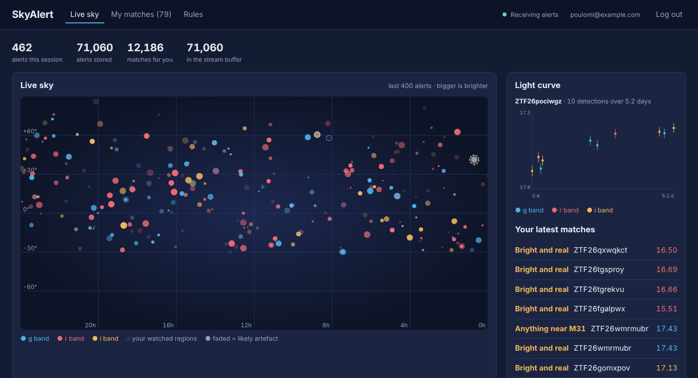
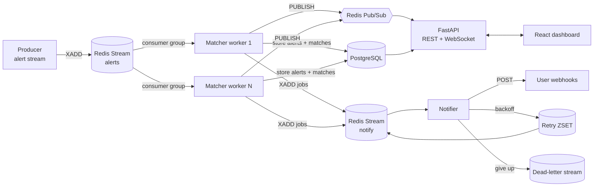

# SkyAlert

A real-time event-processing platform for astronomical transient alerts.

Sky surveys like ZTF (and soon Rubin/LSST) detect hundreds of thousands of changes in the night sky every night: supernovae, variable stars, asteroids, and a lot of instrument artefacts. SkyAlert ingests that alert stream, lets users write rules like *"anything brighter than magnitude 18.5 within 30 arcminutes of M31"*, and delivers matches in real time to a live dashboard and to the user's own webhooks.



## Architecture



| Component | What it does | Code |
|---|---|---|
| Producer | Simulates a ZTF-like alert stream (transients, variable stars, artefacts) | `backend/app/producer.py` |
| Matcher workers | Consume the stream in a consumer group, store alerts, evaluate rules, fan out | `backend/app/worker.py` |
| Rule engine | Compiles rules; spatial grid index so each alert is checked only against nearby rules | `backend/app/rules.py` |
| Notifier | Webhook delivery with retries, exponential backoff, per-user rate limit, DLQ, SSRF guard | `backend/app/notifier.py` |
| API | Auth (JWT), rules CRUD, cursor-paginated alerts/matches, light curves, WebSocket push, rate limiting, Prometheus metrics | `backend/app/main.py` |
| Dashboard | Live sky map, light curves, rule editor, match history | `frontend/src` |

## Measured performance

All numbers come from the scripts in this repo, run on a single laptop-class machine.

| What | Result |
|---|---|
| Rule matching, 10,000 rules (90% spatial), brute force | p50 1,348 µs, p99 8,995 µs per alert |
| Rule matching, same rules, grid index | **p50 130 µs, p99 319 µs per alert (17x faster)**, identical results |
| End-to-end ingest (Redis Stream → Postgres, 2 workers) | **30,000 queued alerts drained in 4.5 s ≈ 6,700 alerts/s** |
| End-to-end correctness run | 3,000 alerts → 3,000 stored (0 duplicates), 497 matches, all 3,000 alerts + 497 matches pushed over WebSocket, 0 pending messages |

Reproduce the matching benchmark with `cd backend && python -m scripts.benchmark_matching`.

## Design decisions worth talking about

**At-least-once delivery, idempotent processing.** Workers ACK a batch only after the database transaction commits. If a worker crashes mid-batch, it re-reads its own pending messages on restart, and other workers take over abandoned messages with `XAUTOCLAIM`. Inserts are deduplicated on the survey's unique `candid`, so a redelivered message never creates a duplicate alert or match. (Trade-off: a crash between commit and fan-out can drop that batch's live notifications. Fixing it fully would need an outbox table.)

**Spatial index for rule matching.** Most rules are cone searches. Checking every rule against every alert is O(rules). The index splits the sky into 1° cells and registers each cone in every cell it can touch, using the exact RA half-width `asin(sin r / cos δ)` and treating cones that reach a pole as covering all RA. Lookups return a superset, and an exact haversine check removes false positives. A property test compares the index to brute force on thousands of random alerts, including cones across RA = 0/360 and around the poles.

**Hot-reloading rules without polling the database.** Changing a rule increments a `rules:version` key in Redis. Workers compare it before each batch and rebuild their in-memory index only when it changed, with a 30-second fallback refresh in case an increment was lost.

**Retries that don't block the queue.** A failed webhook isn't retried with `sleep()`, which would stall every other delivery. It goes into a Redis sorted set scored by its due time (exponential backoff with full jitter). A loop moves due jobs back onto the stream, and `ZREM` guarantees only one notifier moves each job. 4xx responses go straight to the dead-letter stream; 5xx, 429 and network errors are retried up to 5 times.

**Protecting the system and its users.**
- Webhook URLs that resolve to private, loopback or link-local addresses (e.g. cloud metadata at `169.254.169.254`) are refused, which prevents SSRF.
- Per-client fixed-window rate limiting on the API, and per-user rate limiting on webhooks (deferred, not dropped).
- Rate limiter fails open: if Redis is down, the API keeps serving.
- Users can only see and change their own rules and matches (tested).
- Passwords hashed with PBKDF2-SHA256 (310k iterations); rule fields are whitelisted, never `eval`'d.

**Backpressure in the browser.** The WebSocket hook buffers incoming messages and flushes them to React state 4 times a second, so a fast stream doesn't re-render on every message. It reconnects with exponential backoff and jitter.

**Cursor pagination.** `/api/alerts` and `/api/matches` page with `?cursor=<last id>` instead of `OFFSET`, so page 1,000 is as fast as page 1 and new rows don't shift pages.

## Running it

### With Docker (everything)

```bash
docker compose up --build
```

Open http://localhost:8080, create an account, add a rule (try "Start from an example"), and watch the sky fill in. The producer streams 20 alerts/s by default; change it with `ALERT_RATE=200 docker compose up`.

To test webhooks against a receiver on your own machine, set `ALLOW_PRIVATE_WEBHOOKS=true`, or use a public endpoint such as webhook.site.

### Locally, for development

Requirements: Python 3.12+, Node 22+, Redis. Postgres is optional (SQLite is used if `DATABASE_URL` is not set).

```bash
# terminal 1: backend
cd backend
python -m venv .venv && source .venv/bin/activate
pip install -r requirements-dev.txt
uvicorn app.main:app --reload

# terminal 2: matcher worker (run several with different --name and --metrics-port)
cd backend && python -m app.worker --name w1

# terminal 3: notifier
cd backend && python -m app.notifier --name n1

# terminal 4: alert producer
cd backend && python -m app.producer --rate 20

# terminal 5: frontend (proxies /api and /ws to localhost:8000)
cd frontend && npm install && npm run dev
```

Then open http://localhost:5173.

### Tests

```bash
cd backend && python -m pytest -q
```

35 tests cover auth, ownership checks, validation, pagination, rate limiting, the rule engine (property test against brute force), end-to-end worker processing with fan-out, idempotent redelivery, crash recovery and claiming, malformed-message handling, rule hot-reload, webhook retries/backoff/DLQ, SSRF blocking and the per-user webhook limit. Redis is replaced with `fakeredis`, so the suite needs no running services. CI runs the tests, a benchmark smoke test, the frontend build and the Docker build on every push.

## API

| Method | Path | Description |
|---|---|---|
| POST | `/api/auth/register`, `/api/auth/login` | Returns a JWT |
| GET | `/api/me` | Current user |
| GET, POST | `/api/rules` | List or create rules (max 100 per user) |
| PUT, DELETE | `/api/rules/{id}` | Update or delete a rule |
| GET | `/api/alerts?limit&cursor&object_id&max_mag&min_rb&fid` | Recent alerts, newest first |
| GET | `/api/objects/{object_id}/lightcurve` | All detections of one object |
| GET | `/api/matches?limit&cursor&rule_id` | Your matches |
| GET | `/api/stats` | Counters for the dashboard |
| WS | `/ws?token=…` | Pushes `{"type":"alert"}` for every alert and `{"type":"match"}` for your matches |
| GET | `/healthz`, `/metrics` | Health check and Prometheus metrics (workers also expose metrics on :9100) |

Interactive docs are at http://localhost:8000/docs.

Example rule:

```json
{
  "name": "Bright near M31",
  "conditions": [
    {"field": "magpsf", "op": "lt", "value": 18.5},
    {"field": "rb", "op": "gte", "value": 0.7}
  ],
  "cone": {"ra": 10.6847, "dec": 41.269, "radius_arcsec": 1800},
  "webhook_url": "https://example.com/hook"
}
```

## Using a real alert feed

The producer is a simulator. To use real ZTF alerts, subscribe to a public broker (Fink, ALeRCE, ANTARES or Lasair all offer Kafka streams), map each alert to the fields above (`candid`, `object_id`, `ra`, `dec`, `magpsf`, `sigmapsf`, `fid`, `rb`, `ndethist`, `jd`), and `XADD` it to `alerts:stream`. Nothing downstream changes.

## What I'd do next

- Alembic migrations instead of `create_all`
- Outbox table so live notifications survive a crash between commit and publish
- Partition the alerts table by night and add a retention policy
- HEALPix instead of an RA/Dec grid, for equal-area cells
- Sign webhook payloads with HMAC so receivers can verify them
- Grafana dashboard for the Prometheus metrics; deploy to a small cloud VM
